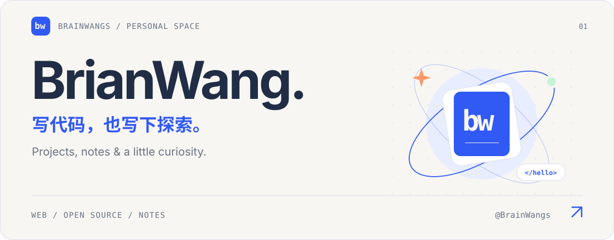
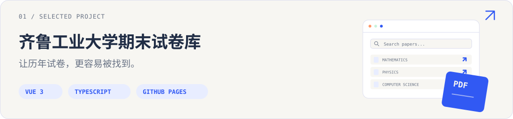
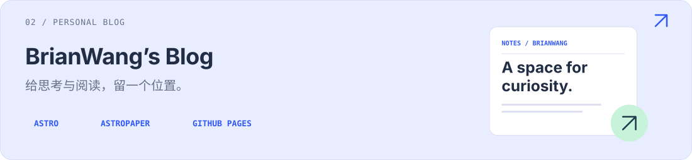

<picture>
  <source media="(prefers-color-scheme: dark) and (max-width: 600px)" srcset="./assets/hero-dark-mobile.svg">
  <source media="(max-width: 600px)" srcset="./assets/hero-light-mobile.svg">
  <source media="(prefers-color-scheme: dark)" srcset="./assets/hero-dark.svg">
  
</picture>

  <a href="https://brainwangs.github.io/zh/">个人博客</a> &nbsp; / &nbsp;
  <a href="https://github.com/BrainWangs?tab=repositories">全部项目</a> &nbsp; / &nbsp;
  <a href="https://brainwangs.github.io/QLU_FinalExamPaper/">试卷库</a>

你好，我是 <strong>BrianWang</strong>，也就是 <a href="https://github.com/BrainWangs">@BrainWangs</a>。这里放着我的项目、工具和学习记录。

<h2>Selected work ／ 精选项目</h2>

<a href="https://brainwangs.github.io/QLU_FinalExamPaper/">
<picture>
  <source media="(prefers-color-scheme: dark) and (max-width: 600px)" srcset="./assets/exam-dark-mobile.svg">
  <source media="(max-width: 600px)" srcset="./assets/exam-light-mobile.svg">
  <source media="(prefers-color-scheme: dark)" srcset="./assets/exam-dark.svg">
  
</picture>
</a>

<a href="https://brainwangs.github.io/QLU_FinalExamPaper/">打开试卷库 ↗</a> &nbsp; · &nbsp; <a href="https://github.com/BrainWangs/QLU_FinalExamPaper">查看源码</a>

<a href="https://brainwangs.github.io/zh/">
<picture>
  <source media="(prefers-color-scheme: dark) and (max-width: 600px)" srcset="./assets/blog-dark-mobile.svg">
  <source media="(max-width: 600px)" srcset="./assets/blog-light-mobile.svg">
  <source media="(prefers-color-scheme: dark)" srcset="./assets/blog-dark.svg">
  
</picture>
</a>

<a href="https://brainwangs.github.io/zh/">进入博客 ↗</a> &nbsp; · &nbsp; <a href="https://brainwangs.github.io/zh/posts">浏览文章</a> &nbsp; · &nbsp; <a href="https://github.com/BrainWangs/BrainWangs.github.io">查看源码</a>

<h2>In the toolbox ／ 项目中的工具</h2>

<code>Vue 3</code> <code>TypeScript</code> <code>Vite</code> <code>Astro</code> <code>Electron</code> <code>GitHub Pages</code>

Open-source shelf ／ 也在关注的开源项目

<ul>
<li><a href="https://github.com/BrainWangs/BongoCat">BongoCat</a> — 跨平台互动桌宠。Fork 自 <a href="https://github.com/ayangweb/BongoCat">ayangweb/BongoCat</a>。</li>
<li><a href="https://github.com/BrainWangs/Kazumi">Kazumi</a> — 番剧采集与播放应用。Fork 自 <a href="https://github.com/Predidit/Kazumi">Predidit/Kazumi</a>。</li>
</ul>

Make something useful. Keep something curious.

